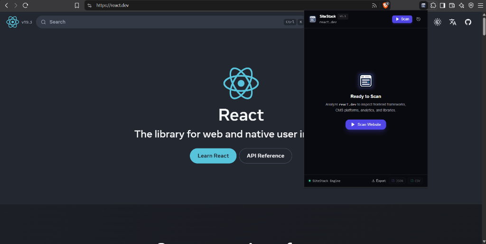
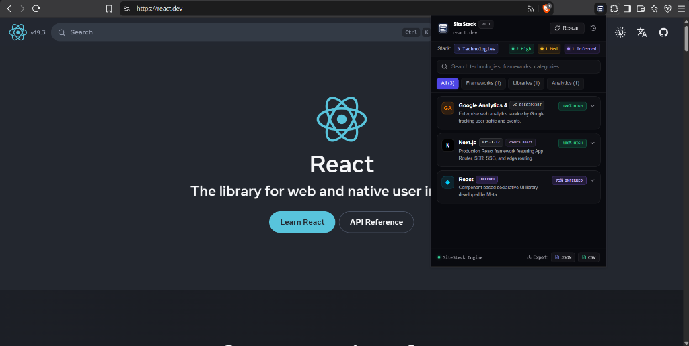
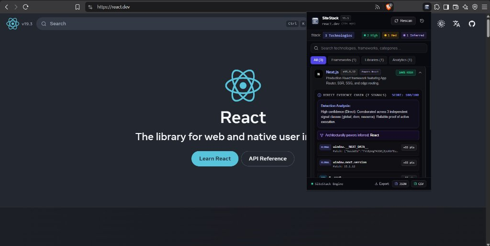
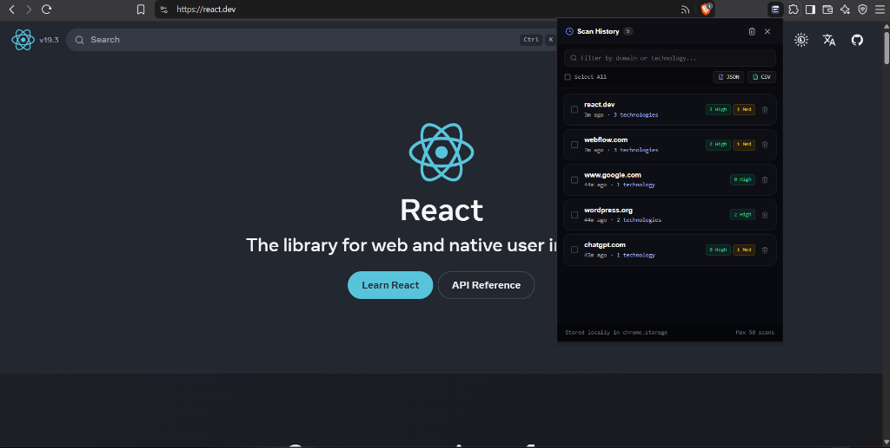

# SiteStack — Technology Stack Profiler

> **Know what's powering any website.**  
> A high-precision, privacy-first technology intelligence browser extension built with Manifest V3, React 18, and TypeScript.

---

## Overview

**SiteStack** is a lightweight, privacy-focused browser extension that inspects, analyzes, and explains the technology stack powering any website you visit.

Unlike traditional technology profilers that rely on single regex matches, unexplainable black-box scores, or continuous background network interception, SiteStack utilizes a **passive 2-stage probing pipeline** and an **explainable multi-class corroboration engine**. It reveals not just *what* technology is present, but *how* it was detected, *which* version is running, *why* the confidence score was assigned, and whether the technology was directly detected or architecturally inferred.

---

## The Problem SiteStack Solves

Most existing technology profiling extensions suffer from several core architectural flaws:

1. **Single-Signal False Positives:** Many profilers declare a technology present based on a single CSS class name or a generic script filename (e.g., claiming React because a third-party widget loaded a script named `react.min.js`). SiteStack requires cross-class corroboration across independent browser signal classes to achieve High confidence.
2. **Ambiguous Black-Box Scoring:** Most profilers present a percentage score without explaining its mathematical basis. SiteStack provides an **Explainable Evidence Drawer** detailing the exact signals, weights, and point contributions that formed the score.
3. **Telemetry Conflated with Hosting:** Websites hosted on Amazon Web Services or custom servers that deploy client-side analytics (such as Vercel Analytics or Cloudflare Web Analytics) are routinely misidentified as being hosted on Vercel or Cloudflare. SiteStack enforces strict architectural safeguards that cap telemetry-only signals and disclaim hosting assumptions.
4. **Invasive Permissions & Background Snooping:** Typical profilers request broad `<all_urls>` and `webRequest` permissions to passively monitor every URL you visit in the background. SiteStack operates strictly on user demand via `activeTab`, performs zero background tracking, and executes 100% locally.

---

## Key Features

- **24 Curated Technologies Across 8 Categories:** Targeted, high-precision detection for major Content Management Systems, Ecommerce Engines, Frontend Frameworks, UI Libraries, Analytics, Marketing Beacons, Payments, and Infrastructure.
- **Explainable Evidence Drawer:** Inspect the exact signals that triggered each detection — window globals, structural DOM selectors, meta tags, and ResourceTiming asset URLs — complete with signal weights and matched values.
- **Multi-Class Corroboration Engine:** High-confidence detections ($\ge 80\%$) mathematically require cross-signal corroboration across at least two independent signal classes, eliminating single-signal false positives.
- **Architectural Dependency Inference:** Intelligently maps parent-child dependencies (e.g., Next.js $\implies$ React, VitePress $\implies$ Vue.js, WooCommerce $\implies$ WordPress) with dedicated `INFERRED` badges and calibrated confidence scores.
- **Semantic Version Extraction & Maturity Classification:** Extracts exact software versions from runtime objects, meta generators, and versioned assets, classifying them into `stable`, `prerelease`, `development`, or `unknown`.
- **Infrastructure Telemetry Safeguards:** Separates client-side telemetry beacons (such as Vercel Analytics or Cloudflare Insights) from true server infrastructure hosting, preventing deceptive claims.
- **Sub-5ms Evaluation Latency:** Pure synchronous rule evaluation averages ~1.6ms (P95 < 5.3ms), operating well below the 100ms user-perceived performance budget.
- **100% Local & Privacy-First:** Zero programmatic network requests, zero telemetry, zero analytics tracking, and zero remote code execution. UI typography uses local system fonts for air-gapped operation.
- **Dedicated Protected-Page Handling:** Intelligently identifies browser-internal pages (`chrome://*`, `brave://*`, `edge://*`, etc.) and displays a clear "Page Not Supported" state rather than misleading scan failure errors.
- **Local History with LRU Cache:** Retains recent scans locally in `chrome.storage.local` with a 50-item LRU bound, duplicate rescan de-duplication, and automatic quota recovery.
- **Standardized RFC 4180 Exports:** Single-scan (11 columns) and multi-scan (13 columns) CSV exports and structured JSON downloads with dual URL semantics (`scannedWebsite` and `technologyWebsite`).

---

## Supported Technology Catalog

SiteStack currently supports 24 high-priority web technologies across 8 distinct categories:

| Category | Technology | Official Website | Primary Detection Signals |
| :--- | :--- | :--- | :--- |
| **CMS** | [WordPress](https://wordpress.org) | `wordpress.org` | `window.wp`, `generator` meta, `/wp-content/` assets |
| | [Webflow](https://webflow.com) | `webflow.com` | `window.Webflow`, `html[data-wf-page]`, `assets.website-files.com` |
| | [Wix](https://wix.com) | `wix.com` | `window.wixBiSession`, `window.wixPerformanceMeasurements`, `static.wixstatic.com` |
| **Ecommerce** | [Shopify](https://shopify.com) | `shopify.com` | `window.Shopify`, `window.ShopifyAnalytics`, `cdn.shopify.com` |
| | [WooCommerce](https://woocommerce.com) | `woocommerce.com` | `window.woocommerce_params`, `body.woocommerce`, `/plugins/woocommerce/` |
| **Frameworks** | [Next.js](https://nextjs.org) | `nextjs.org` | `window.__NEXT_DATA__`, `window.__next_f`, `#__next`, `/_next/static/` |
| | [Vue.js](https://vuejs.org) | `vuejs.org` | `window.Vue`, `window.__VUE__`, `[data-v-app]`, scoped CSS signatures |
| | [VitePress](https://vitepress.dev) | `vitepress.dev` | `window.__VITEPRESS__`, `window.__VP_HASH_MAP__`, `generator` meta |
| | [Angular](https://angular.dev) | `angular.dev` | `window.ng`, `window.getAllAngularRootElements`, `[ng-version]`, `<app-root>` |
| **Libraries** | [React](https://react.dev) | `react.dev` | `window.React`, `[data-reactroot]`, `react.min.js` runtime script |
| | [jQuery](https://jquery.com) | `jquery.com` | `window.jQuery.fn.jquery`, `window.$.fn.jquery`, `jquery.min.js` |
| | [Bootstrap](https://getbootstrap.com) | `getbootstrap.com` | `window.bootstrap.Tooltip.VERSION`, `bootstrap.min.css/js` |
| | [Tailwind CSS](https://tailwindcss.com) | `tailwindcss.com` | `--tw-` stylesheet properties, `--tw-ring-offset-shadow`, utility class patterns |
| **Analytics** | [Google Analytics 4](https://analytics.google.com) | `analytics.google.com` | `window.gtag`, `window.gaGlobal`, `google-analytics.com/g/collect` |
| | [Google Tag Manager](https://tagmanager.google.com) | `tagmanager.google.com` | `window.google_tag_manager`, `googletagmanager.com/gtm.js` |
| | [Hotjar](https://hotjar.com) | `hotjar.com` | `window.hj`, `window._hjSettings`, `static.hotjar.com/c/hotjar-*.js` |
| **Marketing** | [Meta Pixel](https://www.facebook.com/business/tools/meta-pixel) | `facebook.com` | `window.fbq`, `window._fbq`, `connect.facebook.net/.../fbevents.js` |
| | [HubSpot](https://hubspot.com) | `hubspot.com` | `window._hsq`, `window.HubSpotConversations`, `js.hs-scripts.com` |
| | [Intercom](https://intercom.com) | `intercom.com` | `window.Intercom`, `window.intercomSettings`, `widget.intercom.io` |
| **Payments** | [Stripe](https://stripe.com) | `stripe.com` | `window.Stripe`, `js.stripe.com/v3/` iframe and script elements |
| | [Razorpay](https://razorpay.com) | `razorpay.com` | `window.Razorpay`, `checkout.razorpay.com/v1/checkout.js` |
| **Infrastructure** | [Cloudflare](https://cloudflare.com) | `cloudflare.com` | `window.__cfRLUnblockHandlers`, `static.cloudflareinsights.com/beacon.min.js` |
| | [Vercel](https://vercel.com) | `vercel.com` | `window.va`, `window.si`, `/_vercel/insights/script.js` |
| | [Netlify](https://netlify.com) | `netlify.com` | `identity.netlify.com`, `/.netlify/functions/` API requests |

---

## How Detection Works

SiteStack executes a decoupled 4-stage pipeline that runs purely in local memory upon user request:

```
┌────────────────────────────────────────────────────────┐
│                   Active Browser Tab                   │
└──────────────┬──────────────────────────┬──────────────┘
               │                          │
        (Isolated World)             (Main World)
               │                          │
               ▼                          ▼
     DOM Selectors, Meta Tags,    Allowlisted Window
        ResourceTiming URLs             Globals
               │                          │
               └──────────────┬───────────┘
                              │
                              ▼
                 Harvested Signals Payload
                              │
                              ▼
                Pure Evaluator (evaluator.ts)
           - Multi-Class Corroboration Engine
           - Architectural Dependency Graph
           - Semantic Version Extraction
                              │
                              ▼
                 Explainable ScanResult
         (Popup UI, Local History, CSV/JSON Export)
```

### 1. Signal Classes
Signals are harvested across 4 passive client-side classes:
- **`global`:** Allowlisted global JavaScript variables in the page context.
- **`dom`:** Unique DOM selectors, container IDs, and element attributes.
- **`meta`:** Standard HTML `<meta>` tags (e.g., `generator`, platform identifiers).
- **`resource`:** Asset URLs queried from the browser's `performance.getEntriesByType('resource')` API (capped at 350 items).

*(Note: SiteStack does not scan HTTP response headers, as doing so would require broad background network permissions).*

### 2. Multi-Class Corroboration & Confidence Tiers
To prevent single-signal false positives, confidence scores are calculated using diminishing returns and cross-class corroboration bonuses:

| Tier | Score Range | Meaning | Required Evidence |
| :---: | :---: | :--- | :--- |
| **High** | $80 - 100\%$ | Confirmed production presence. | Multi-class corroboration ($\ge 2$ independent signal classes, e.g. global + DOM or resource + meta). |
| **Medium** | $50 - 79\%$ | Strong probable presence or architectural inference. | Strong single signal class (e.g., global object `window.wp`) or inferred dependency. |
| **Low** | $30 - 49\%$ | Weak or partial signal (e.g., client-side telemetry beacon). | Single supporting signal (e.g., Cloudflare beacon script = 45%, Vercel analytics = 35%). |
| **Discarded** | $< 30\%$ | Below noise threshold; discarded. | Isolated weak hints (e.g., DevTools hook = 25%). |

### 3. Direct vs Inferred Detections
When a detected technology guarantees the underlying presence of another (e.g., Next.js guarantees React, VitePress guarantees Vue.js, WooCommerce guarantees WordPress):
- Inferred technologies display a distinct **`INFERRED`** badge.
- Inferred technologies receive calibrated confidence scores based on the parent's confidence level, rather than blindly inheriting identical scores.
- If genuine independent browser evidence is detected for the child technology (e.g., direct `window.React` alongside Next.js), the child is upgraded to a Direct detection with its own calculated score.

---

## Screenshots

Real screenshots captured from the installed SiteStack v1.1.0 extension.

### Ready to Scan



Initial state showing the target domain and scan action.

### Technology Stack Results



Actual technology detection results on react.dev.

### Explainable Evidence Drawer



Direct evidence chain and individual signal contributions.

### Local Scan History



Locally stored scan records and export controls.

---

## Installation

SiteStack is available as a verified, pre-packaged distribution archive and can also be built from source code.

### Browser Compatibility
> **Validated Environments:** SiteStack v1.1.0 has been manually validated on **Google Chrome** and **Brave Browser**.

### Quick Install (Packaged Extension)
1. Download the release package from [GitHub Releases](https://github.com/Dushyant91/sitestack/releases):
   - **Package:** [Download sitestack-v1.1.0-stable.zip](https://github.com/Dushyant91/sitestack/releases)
   - **SHA-256:** `C81887146F96C9DFB5D8C2950698DAB775D8CAD1248046DEB0E7E74973B038CD`
2. Extract the ZIP file into a local folder.
3. In Chrome or Brave, navigate to:
   - Chrome: `chrome://extensions/`
   - Brave: `brave://extensions/`
4. Toggle **Developer mode** in the top-right corner.
5. Click **Load unpacked** in the top-left toolbar and select the extracted folder.
6. Pin SiteStack to your browser toolbar for easy access.

For detailed installation steps and checksum verification, see [docs/INSTALLATION.md](docs/INSTALLATION.md).

### Build from Source
```bash
git clone https://github.com/username/sitestack.git
cd sitestack
git checkout v1.1.0
npm install
npm test          # 352 passing tests across 26 suites
npm run build     # Outputs to dist/
```
Load the compiled `dist/` directory using **Load unpacked** in your browser.

---

## How to Use SiteStack

1. **Scan a Website:** Navigate to any regular website (HTTP or HTTPS) and click the SiteStack icon in your browser toolbar. If not scanned automatically, click **Scan Current Tab**.
2. **Filter & Search:** Use category tabs (`Frameworks`, `CMS`, `CSS`, `Analytics`, etc.) or type into the search bar to filter detected technologies in real time.
3. **Inspect Evidence:** Click any technology card to expand its **Evidence Drawer**. Review the specific globals, DOM elements, or resource files that corroborated the detection, along with individual signal weights.
4. **Review Scan History:** Click the **History** button in the footer to inspect up to 50 previous scans.
5. **Export Results:** Click **Export** to download your findings:
   - **Single-Scan CSV:** 11-column breakdown of the active scan.
   - **Multi-Scan CSV:** 13-column historical record spanning all cached scans.
   - **Structured JSON:** Comprehensive machine-readable scan payload.

---

## Privacy & Security

SiteStack is built from the ground up to respect user privacy:

- **Zero Application Network Calls:** No telemetry, tracking, remote API calls, or external web fonts.
- **Zero Remote Scripts:** Complies strictly with Manifest V3 security rules (`script-src 'self'`).
- **Minimal Permissions:** Only requests `activeTab` (temporary access only when invoked by clicking), `scripting` (passive in-memory probes), and `storage` (local scan history and session cache).
- **No Form or Password Access:** SiteStack never reads user input values, form textareas, passwords, cookies, or website storage (`localStorage`, `sessionStorage`, `indexedDB`).
- **Multi-Layer URL Sanitization:** Scanned URLs and evidence strings are automatically sanitized across evaluation, storage, and exports to remove authentication tokens, API keys, session IDs, `utm_*` marketing tags, `fbclid`, `gclid`, and hash fragments.
- **Data Exits Only on Demand:** Scan data never leaves the browser sandbox programmatically; the only exit path is manual, user-initiated file export (CSV/JSON) to your local drive.

Read our complete privacy policy in [docs/PRIVACY.md](docs/PRIVACY.md).

---

## Known Limitations & Accuracy Caveats

1. **Curated Catalog:** SiteStack currently detects 24 high-priority technologies. It does not attempt to detect every arbitrary package or library on npm.
2. **Obfuscated & Custom Bundles:** Web applications built with aggressive identifier renaming or non-standard architectures that omit recognizable globals, meta tags, or selectors may receive lower confidence scores or not be detected.
3. **Response Headers Excluded:** SiteStack does not capture or analyze HTTP response headers. Doing so would require broad background interception permissions (`webRequest`), violating our privacy-first principles.
4. **Client Telemetry vs True Hosting:** Detecting client-side analytics (such as `window.va` or Cloudflare Web Analytics) indicates the presence of that service, but does not guarantee the website is hosted on that platform's edge infrastructure.
5. **Browser Internal Pages:** Chrome, Brave, and other Chromium browsers prohibit extensions from inspecting internal pages (e.g., `chrome://*`, `brave://*`, extension stores). SiteStack safely detects these pages and displays a "Page Not Supported" message.
6. **Curated Benchmarks vs Real-World Execution:** Our reported sub-5ms evaluation benchmarks reflect the pure CPU processing time of the rules engine. Total end-to-end scanning latency also includes the browser's native DOM inspection and ResourceTiming collection.

---

## Release Information

- **Current Version:** `1.1.0`
- **Release Commit:** `60378dec11a92b0f50c6223cd112950a060f5d7d`
- **Git Tag:** `v1.1.0`
- **Distribution Package:** [Download sitestack-v1.1.0-stable.zip](https://github.com/Dushyant91/sitestack/releases)
- **SHA-256 Checksum:** `C81887146F96C9DFB5D8C2950698DAB775D8CAD1248046DEB0E7E74973B038CD`
- **Changelog:** See [CHANGELOG.md](CHANGELOG.md) for full version history.

---

## Contributing & Feedback

Contributions, rule suggestions, and bug reports are welcome! Please review [CONTRIBUTING.md](CONTRIBUTING.md) for instructions on proposing new detection rules, adding test fixtures, and submitting pull requests.

---

## License

SiteStack is open-source software distributed under the [MIT License](LICENSE).
