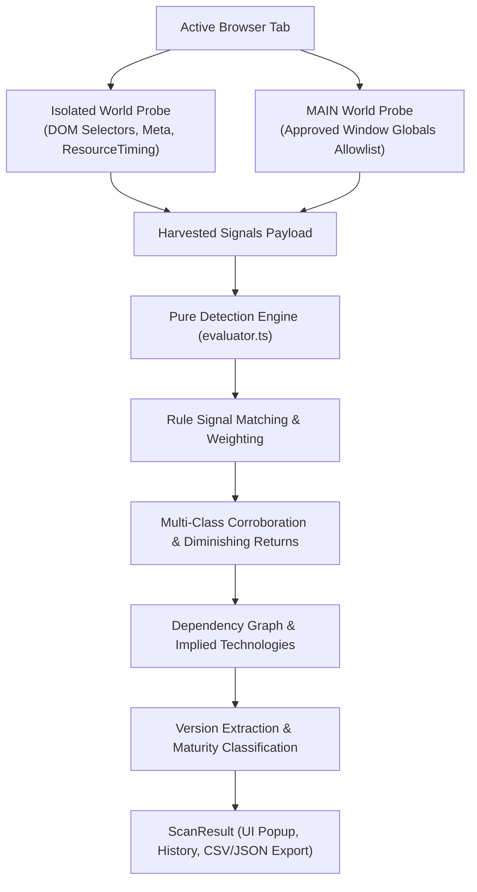

# SiteStack — Technology Stack Profiler

> **Know what's powering any website.**  
> A high-precision, privacy-first technology intelligence Chrome extension built with Manifest V3, React 18, and TypeScript.

---

## Overview

**SiteStack** is a modern, lightweight, privacy-focused browser extension that instantly inspects, analyzes, and explains the complete technology stack powering any website you visit.

Unlike legacy stack profilers that rely on single regex matches, loose heuristics, or invasive background network monitoring, SiteStack employs a **4-tier hybrid probe pipeline** and an **explainable multi-class corroboration algorithm**. It reveals not just *what* technology is present, but *how* it was detected, *which* version is running, *why* the confidence score was assigned, and whether the technology was directly detected or architecturally inferred.

---

## Key Features

- **24 Curated Technologies Across 8 Categories:** Deep detection coverage for major Content Management Systems, Frontend Frameworks, UI Libraries, Web Analytics, Marketing Beacons, Ecommerce Engines, Payment Gateways, and Cloud Infrastructure.
- **Explainable Evidence Drawer:** Inspect the exact signals that triggered each detection — window globals, DOM selectors, meta tags, and ResourceTiming asset URLs — complete with individual signal weights and matched values.
- **Multi-Class Corroboration Engine:** High-confidence detections ($\ge 80\%$) strictly require cross-signal corroboration across at least two independent signal classes, eliminating single-signal false positives.
- **Architectural Dependency Inference:** Intelligently maps parent-child dependencies (e.g. Next.js $\implies$ React, VitePress $\implies$ Vue.js, WooCommerce $\implies$ WordPress) with dedicated `INFERRED` badges and independently calibrated confidence scores.
- **Semantic Version Extraction & Maturity Classification:** Extracts exact software versions from runtime objects, meta generators, and versioned assets, classifying them into `stable`, `prerelease`, `development`, or `unknown`.
- **Infrastructure Telemetry Safeguards:** Separates client-side telemetry beacons (such as Vercel Analytics or Cloudflare Insights) from true server infrastructure hosting, preventing deceptive claims.
- **Sub-5ms Execution Latency:** Pure synchronous rule evaluation takes an average of ~1.6ms (P95 < 4.2ms), operating well below the 100ms user-perceived performance budget.
- **Strictly Local & Privacy-First:** Zero programmatic network requests, zero telemetry, zero user tracking, and zero remote code execution. Scans run only on user demand with multi-layer URL sanitization.
- **Local History with LRU Caching:** Retains recent scans in `chrome.storage.local` with a 50-item LRU bound, duplicate rescan de-duplication, and automatic quota recovery.
- **Standardized RFC 4180 Exports:** Single-scan (11 columns) and multi-scan (13 columns) CSV exports and structured JSON downloads with unambiguous dual URL semantics (`scannedWebsite` and `technologyWebsite`).

---

## Technology Detection Catalog

SiteStack currently supports 24 high-priority web technologies across 8 distinct categories:

| Category | Technology | Official Website | Primary Signals | Version Extraction Source |
| :--- | :--- | :--- | :--- | :--- |
| **CMS** | [WordPress](https://wordpress.org) | `wordpress.org` | `window.wp`, `window._wpemojiSettings`, `generator` meta, `/wp-content/` assets | `<meta name="generator">`, emoji script URL |
| | [Webflow](https://webflow.com) | `webflow.com` | `window.Webflow`, `html[data-wf-page]`, `generator` meta, `assets.website-files.com` | — |
| | [Wix](https://wix.com) | `wix.com` | `window.wixBiSession`, `window.wixPerformanceMeasurements`, `static.wixstatic.com` | — |
| **Ecommerce** | [Shopify](https://shopify.com) | `shopify.com` | `window.Shopify`, `window.ShopifyAnalytics`, `cdn.shopify.com` assets | `window.Shopify.theme.version` |
| | [WooCommerce](https://woocommerce.com) | `woocommerce.com` | `window.woocommerce_params`, `body.woocommerce`, `/plugins/woocommerce/` assets | `<meta name="generator">`, core script URL |
| **Frameworks** | [Next.js](https://nextjs.org) | `nextjs.org` | `window.__NEXT_DATA__`, `window.__next_f`, `#__next`, `/_next/static/` chunks | `window.next.version` |
| | [Vue.js](https://vuejs.org) | `vuejs.org` | `window.Vue`, `window.__VUE__`, `[data-v-app]`, scoped CSS signatures | `window.Vue.version`, npm package URL |
| | [VitePress](https://vitepress.dev) | `vitepress.dev` | `window.__VITEPRESS__`, `window.__VP_HASH_MAP__`, `generator` meta | `<meta name="generator">` |
| | [Angular](https://angular.dev) | `angular.dev` | `window.ng`, `window.getAllAngularRootElements`, `[ng-version]`, `<app-root>` | `[ng-version]` attribute |
| **Libraries** | [React](https://react.dev) | `react.dev` | `window.React`, `[data-reactroot]`, `react.min.js` runtime script | `window.React.version`, npm package URL |
| | [jQuery](https://jquery.com) | `jquery.com` | `window.jQuery.fn.jquery`, `window.$.fn.jquery`, `jquery.min.js` asset | `window.jQuery.fn.jquery`, script URL |
| | [Bootstrap](https://getbootstrap.com) | `getbootstrap.com` | `window.bootstrap.Tooltip.VERSION`, `bootstrap.min.css/js`, doc assets | `window.bootstrap.Tooltip.VERSION`, asset URL |
| | [Tailwind CSS](https://tailwindcss.com) | `tailwindcss.com` | `--tw-` stylesheet properties, `--tw-ring-offset-shadow`, utility class patterns | — |
| **Analytics** | [Google Analytics 4](https://analytics.google.com) | `analytics.google.com` | `window.gtag`, `window.gaGlobal`, `google-analytics.com/g/collect` | Measurement ID (`G-XXXXXXXXXX`) |
| | [Google Tag Manager](https://tagmanager.google.com) | `tagmanager.google.com` | `window.google_tag_manager`, `googletagmanager.com/gtm.js` | Container ID (`GTM-XXXXXXX`) |
| | [Hotjar](https://hotjar.com) | `hotjar.com` | `window.hj`, `window._hjSettings`, `static.hotjar.com/c/hotjar-*.js` | — |
| **Marketing** | [Meta Pixel](https://www.facebook.com/business/tools/meta-pixel) | `facebook.com` | `window.fbq`, `window._fbq`, `connect.facebook.net/.../fbevents.js` | — |
| | [HubSpot](https://hubspot.com) | `hubspot.com` | `window._hsq`, `window.HubSpotConversations`, `js.hs-scripts.com` | — |
| | [Intercom](https://intercom.com) | `intercom.com` | `window.Intercom`, `window.intercomSettings`, `widget.intercom.io` | — |
| **Payments** | [Stripe](https://stripe.com) | `stripe.com` | `window.Stripe`, `js.stripe.com/v3/` iframe and script elements | — |
| | [Razorpay](https://razorpay.com) | `razorpay.com` | `window.Razorpay`, `checkout.razorpay.com/v1/checkout.js` | — |
| **Infrastructure** | [Cloudflare](https://cloudflare.com) | `cloudflare.com` | `window.__cfRLUnblockHandlers`, `static.cloudflareinsights.com/beacon.min.js` | — |
| | [Vercel](https://vercel.com) | `vercel.com` | `window.va`, `window.si`, `/_vercel/insights/script.js` | — |
| | [Netlify](https://netlify.com) | `netlify.com` | `identity.netlify.com`, `/.netlify/functions/` API requests | — |

---

## Detection & Scoring Architecture

SiteStack separates technology detection into a clean, decoupled 4-stage pipeline:



### 1. Multi-Class Corroboration Model
- **Signal Classes:** `global`, `meta`, `dom`, `resource`, `header`, and `inferred`.
- **Diminishing Returns:** Within the same signal class, the primary signal receives 100% weight, while subsequent signals receive 40% weight.
- **Class Score Ceiling:** Individual signal classes are capped at 60 points maximum (50 points for `resource`). Consequently, **High confidence ($\ge 80\%$) is mathematically impossible without at least 2 distinct signal classes**.
- **Corroboration Bonus:** When evidence spans multiple classes, a cross-corroboration multiplier is applied:
  - 1 signal class: $1.0\times$
  - 2 signal classes: $1.15\times$
  - 3+ signal classes: $1.30\times$

### 2. Confidence Score Tiers

| Tier | Score Range | Meaning | Required Evidence |
| :---: | :---: | :--- | :--- |
| **High** | $80 - 100\%$ | Definite, production-verified technology presence. | Cross-class corroboration ($\ge 2$ independent signal classes, e.g. global + DOM or resource + meta). |
| **Medium** | $50 - 79\%$ | Strong, probable presence or inferred framework dependency. | Strong single signal class (e.g. global object `window.wp` = 55%) or architectural inference. |
| **Low** | $30 - 49\%$ | Weak or partial signal, such as client telemetry or CDN asset. | Single supporting signal (e.g. Cloudflare beacon script = 45%, Vercel insight script = 35%). |
| **Discarded** | $< 30\%$ | Below noise threshold; discarded from output. | Isolated supporting signals (e.g. React DevTools hook alone = 25%). |

### 3. Architectural Inference Engine
When a parent technology guarantees the underlying presence of a child technology (e.g. Next.js $\implies$ React, VitePress $\implies$ Vue.js, WooCommerce $\implies$ WordPress):
- Inferred technologies display an **`INFERRED`** badge.
- Inferred technologies do **not** simply inherit the parent's score. They are calibrated independently:
  - Parent $\ge 80\%$ (High) $\implies$ Inferred receives **75% Medium**.
  - Parent $50 - 79\%$ (Medium) $\implies$ Inferred receives **50% Medium**.
  - Parent $30 - 49\%$ (Low) $\implies$ Inferred receives **30% Low**.
- If genuine independent browser evidence is discovered for the child technology (e.g. direct `window.React` alongside Next.js), the child is upgraded to a Direct detection with its own calculated score.

### 4. Version Extraction & Maturity Lifecycle
SiteStack extracts exact version strings and classifies their release maturity into four categories:
- **`stable`**: Production release versions (e.g. `18.3.1`, `7.1.4`, `6.0`).
- **`prerelease`**: Feature-frozen previews, release candidates, alphas, or betas (e.g. `14.0.0-rc.2`, `18.3.1-beta.0`).
- **`development`**: Nightly builds, continuous development snapshots, or commit tags (e.g. `11.4.0-dev.20261116`).
- **`unknown`**: Non-version identifiers, measurement tags (e.g. `GTM-XXXXXXX`), or missing versions.

### 5. Client Telemetry vs Cloud Hosting Safeguards
Modern cloud platforms (such as Vercel and Cloudflare) offer client-side telemetry libraries that website owners deploy on third-party servers (e.g. AWS or private infrastructure). SiteStack enforces strict safeguards:
- `window.va` and `window.si` are weighted at 25 (below the 30 noise floor) and cannot independently claim Vercel hosting.
- Telemetry asset scripts (`/_vercel/insights/script.js`) are weighted at 35 (Low).
- Vercel includes a rule-level safeguard (`maxConfidenceScore: 69`), preventing client-side analytics alone from reaching High confidence.
- Cloudflare Web Analytics beacon (`beacon.min.js`) produces 45% Low confidence with an explicit note explaining that it represents client telemetry rather than confirmed DNS or edge hosting.

---

## Performance & Optimization

SiteStack was engineered for zero user friction. Detection evaluation runs synchronously in pure CPU time without network latency.

Benchmark results across 100 iterations on heavy multi-technology stacks:
- **Optimization Budget:** $\le 100.00\text{ ms}$
- **Minimum Execution Time:** $0.62\text{ ms}$
- **Average Execution Time:** $1.64\text{ ms}$
- **P95 Execution Time:** $4.15\text{ ms}$
- **Maximum Execution Time:** $5.33\text{ ms}$

The ResourceTiming scraper is capped at 350 items, keeping the memory overhead of harvested browser signals below 15 KB per scan.

---

## Privacy & Security Model

SiteStack adheres to the strictest privacy principles:
- **Zero Programmatic Network Calls:** No background pings, analytics, beacons, crash reporters, or external APIs from service workers, content probes, or the evaluation engine. (Popup typography loads Google Web Fonts when online, with graceful offline fallbacks to local system fonts).
- **Zero Remote Code:** Fully self-contained local bundle. Complies with Chrome Web Store Manifest V3 policy forbidding remote script execution (`script-src 'self'`).
- **Minimal Permissions:** SiteStack requests only 3 permissions:
  - `activeTab`: Access is granted only when the user explicitly clicks the extension action on the active tab.
  - `scripting`: Injects read-only probing functions in memory.
  - `storage`: Retains up to 50 recent scans locally in `chrome.storage.local`.
- **Zero Form or Input Inspection:** Probes never read input values, textarea elements, passwords, cookies, or user session tokens.
- **Multi-Layer Evidence URL Sanitization:** Scanned URLs and resource evidence URLs are sanitized across evaluation, storage, and exports (`src/shared/url.ts`). Sensitive parameters (`token`, `auth`, `key`, `secret`, `session_id`, `utm_*`, `gclid`, `fbclid`) and hash fragments are permanently stripped.
- **Version Parameter Preservation & Measurement Allowlist:** Safe version parameters (`ver`, `v`) and validated public measurement IDs matching `/^(?:G-[A-Z0-9]+|GTM-[A-Z0-9]+|UA-[0-9]+-[0-9]+)$/i` (`id`, `tid`) are preserved where required for software version extraction; arbitrary user/account IDs are stripped.
- **Automatic Legacy History Migration:** Stored historical records are audited on read; legacy unsanitized records are sanitized and immediately written back to `chrome.storage.local`.

For full details, read our [PRIVACY_POLICY.md](file:///D:/SiteStack/PRIVACY_POLICY.md).

---

## Installation & Usage

### Prerequisites
- Google Chrome, Brave, Microsoft Edge, or any Chromium-based browser supporting Manifest V3.
- Node.js 18.x or higher and npm (for building from source).

### 1. Load Unpacked Extension (Prebuilt)
1. Open Google Chrome and navigate to:
   ```text
   chrome://extensions/
   ```
2. Enable **Developer mode** using the toggle in the top-right corner.
3. Click the **Load unpacked** button.
4. Select the project build directory:
   ```text
   D:\SiteStack\dist
   ```
5. SiteStack is now installed. Pin the icon to your Chrome toolbar for easy access.

### 2. Build from Source
To compile the extension bundle from TypeScript source code:
```bash
# Install dependencies
npm install

# Run complete test suite (307 tests across 21 test files)
npm test

# Build production bundle to dist/
npm run build
```

---

## Export Formats

SiteStack supports both single-scan and multi-scan exports in JSON and RFC 4180 CSV formats. All exports feature unambiguous dual URL fields:
- `scannedWebsite`: The website domain scanned by the user (e.g. `notion.com`).
- `technologyWebsite`: The official project or vendor website for the detected technology (e.g. `https://nextjs.org`).

### CSV Export Schemas
- **Single-Scan CSV (11 Columns):**
  `scannedWebsite`, `technology`, `category`, `version`, `confidenceScore`, `confidenceTier`, `detectionType`, `parentDependency`, `confidenceReason`, `evidenceSummary`, `technologyWebsite`
- **Multi-Scan CSV (13 Columns):**
  `scannedWebsite`, `scanDate`, `url`, `technology`, `category`, `version`, `confidenceScore`, `confidenceTier`, `detectionType`, `parentDependency`, `confidenceReason`, `evidenceSummary`, `technologyWebsite`
  *(Note: Scans with zero detections emit a single row preserving `scannedWebsite`, `scanDate`, and `url`, with 10 empty technology fields).*

---

## Project Documentation

- [PRIVACY_POLICY.md](file:///D:/SiteStack/PRIVACY_POLICY.md) — Comprehensive privacy, security, and permissions verification.
- [BETA_TESTING_GUIDE.md](file:///D:/SiteStack/BETA_TESTING_GUIDE.md) — Beta tester instructions, catalog verification guide, and reporting guidelines.
- [BETA_FEEDBACK_TEMPLATE.md](file:///D:/SiteStack/BETA_FEEDBACK_TEMPLATE.md) — Standardized issue templates for false positives, missing detections, and UI defects.
- [RELEASE_NOTES.md](file:///D:/SiteStack/RELEASE_NOTES.md) — Release notes for Version 1.0.0 (Release Candidate 1).
- [MANUAL_VALIDATION_RESULTS_TEMPLATE.md](file:///D:/SiteStack/MANUAL_VALIDATION_RESULTS_TEMPLATE.md) — Full manual validation checklist and verification matrix.

---

## License

SiteStack is released under the MIT License.
